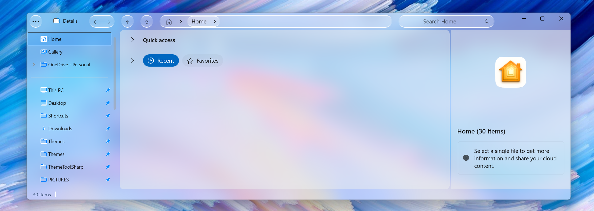

ZEUSosX_044_Crystal_Ge_b26200

Premium WinUI 3 theme for Win11 File Explorer (Germanium Wave 1 b26200.9711). Fixed layout collapse and pixel snapping bugs caused by recent MS updates using subpixel floating-point calibration. Optimized for 150% DPI scale to restore the absolute 24px/27px Crystal Glass symmetry.

## 🔄 Changelog & DPI Differences (Vs Previous Version)

### ⚠️ Important Notice for Users (System Behavior Change)
Starting from this specific Windows configuration:
* **Edition:** Windows 11 Pro / Home (Version 25H2)
* **OS Build:** 26200.9711
* **Experience Pack:** 1000.26100.372.0

Microsoft completely altered the internal graphics compiler and layout engine of the File Explorer window chrome. As a result, older configurations collapsed, causing bad overlapping controls and broken frames. **This theme has been completely rewritten from scratch** with subpixel layout tuning to fix these broken graphical overlapping artifacts and restore the ultra-clean 1-row layout symmetry.

### 🕵️ Technical Breakdown of the XAML Constraints Re-engineering:
* **Navigation Bounds Fix:** NavigationCommands margin increased from 113 to 134.5 to expand the Details-to-Capsule distance back to a verified 27px layout line.
* **Refresh Border Clipping Bypass:** The refreshButton margin was precision-calibrated from 0 to a float value of 6.5. This prevents the 2px Crystal Glass frame from getting swallowed or clipped by the AddressBar container.
* **Multi-Scale Realities:** Due to native WinUI layout rounding discrepancies, this version shifts from a fully universal calibration to a targeted 150% DPI baseline profile to eliminate the 1px/2px floating font and frame jumps found on integer scaling tiers (like 125% and 175%).

ZEUSosX 044 Crystal - Windows 11 File Explorer Styler Theme

### 📐 Calibrated 44px Single-Row Layout with Unified 2px Glass Borders (Optimized for 150% DPI)

An elegant, minimal single-row configuration optimized to remove cluttered stock borders and enforce a synchronized 2px 3D Glass linear gradient outline, micro-calibrated specifically for 150% scaling environments on modern Windows builds (24H2/25H2).

🧬 Behind the Name

• ZEUSosX: Represents the creator, bringing a powerful, stylized aesthetic to the desktop environment.
• 044: Specifies the exact core height of the layout (44 pixels), capturing the engineering effort required to compress the multi-row interface into a single line.
• Crystal: Derived from the ancient Greek word "Κρύσταλλος" (crystal/pure ice), symbolizing the theme's signature glass-like 3D outlines and transparent structural components.

✨ Key Features

• Pure One-Row Geometry: Collapses the cluttered Windows 11 Explorer interface into a single 44px line for maximum screen real estate.
• Unified 2px Glass Borders: Every control element (Back, Forward, Up, Refresh, Address Bar, and Search Box) shares a synchronized 2px 3D Glass linear gradient outline.
• Mac-Style Symmetrical Radii: Globally enforces a strict CornerRadius=16 across all titlebar components and pop-up overflow presenters for a fluid, premium aesthetic.
• Zero-Flicker Solid Hover Overrides: Replaces unstable translucent layers with custom, unblocked high-contrast solid blue accents (#FF057AFD) on foreground hover states to protect text layers from rendering glitches.
• Hidden/Clean Tabs Framework: Features a minimized and locked responsive tab skeleton layout tailored for minimalist setups.
* **Crystal Glass Islands Background:** Injects a micro-calibrated custom background color (`#EDEFEF` with `0.5` opacity) strictly across Home View, Gallery View, and the Details Pane. This eliminates the native raw white background rendering bug, sealing all major workspace layers into unified, translucent glass surfaces.

🎯 High-DPI Test Matrix Info

Rigorously verified across scaling tiers. While optimized strictly for the 150% layout baseline to preserve pure geometric symmetry, the infrastructure functions stably without total layout collapse up to extreme resolution limits (250%).

🚀 Installation Guide

Prerequisites

 • Windhawk installed on your system. Download here: https://windhawk.net/     

Step-by-Step Installation

Follow the standard Windhawk configuration process by installing the Windows 11 File Explorer Styler mod, switching to textual mode, and pasting the custom YAML configuration [1.6].

📋 YAML Configuration Highlights

###  DOWNLOAD
### ** The complete production-ready YAML configuration file is available for direct view and copy here: **                                        ###   [ZEUSosX_044_Crystal_Ge_b26200.yaml](https://github.com/ZEUSosX/ZEUSosX_044_Crystal_Ge_b26200/blob/main/ZEUSosX_044_Crystal_Ge_b26200.yaml)

• Theme Name: ZEUSosX_044_Crystal
• Background Effect: acrylic
• Core Layout Height: 44px

⚠️ Known Bugs & Limitations

This ultra-compressed 1-row layout achieves minimalism via negative XAML bounds. Refer to the referenced repository for manual handling of window dragging, tab strips, and high-DPI font behaviors [1.6].

### 🖱️ Window Dragging (Mouse & Touch)
* **Issue:** Cannot click blindly on the top bar to drag the window.
* **Solution:** Target either the Search Box icon area, or the empty gap between Close/Caption buttons and the Search Box.

### 📑 No Tab Strip UI / Context Warning
* **Issue:** Tab strip region is completely collapsed.
* **Warning:** Never select "Open in new tab" from context menus (the new tab is created but remains invisible/inaccessible).
* **Solution:** Always use "Open in new window" instead.

### 🖥️ Desktop Launch Focus Glitch
* **Issue:** Opening a folder directly from the Windows Desktop may trigger a native focus bug, causing the Address Bar background to lock into solid white.
* **Solution:** Launch File Explorer via "This PC" (My PC) or use a standard pinned shortcut.

### 🔤 DPI Font Behavior
* **Expected:** Minor UI shifts.
* **Cause:** WinUI accessibility overrides.

🔒 Terms of Use & Copyright

Copyright © 2026 ZEUSosX. All rights reserved. Custom Standard Copyright - All Rights Reserved by ZEUSosX [1.6].
Made in Greece, by ZEUSosX, June 2026 (Updated 17 October 2026).
